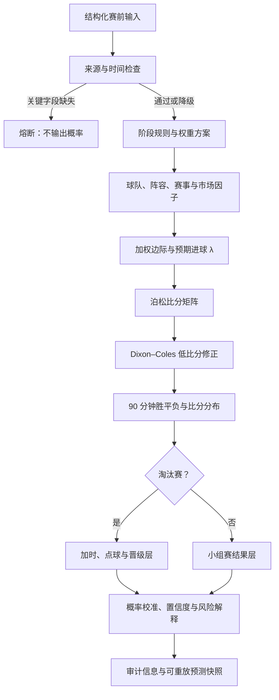

# MatchOracle WorldCup

**一个用于世界杯赛前概率分析的开源足球模型原型。** 项目把球队强度、进球分布、赛事规则、市场隐含概率和数据可靠性检查放进同一条可审计的预测流程，输出常规时间胜平负、比分情景、淘汰赛晋级层和风险解释。

> 当前项目处于研究与验证阶段。历史验证显示，概率校准仍有明显改进空间；本项目不构成投注建议，也没有证据证明它能够稳定优于市场或简单基线。

仓库只发布源代码和可公开的数据样例。这里**没有部署线上网站或在线服务**。仓库保留了可在本机运行的 Flask 页面和 API，供开发、演示和模型调用；运行它不代表项目已接入实时数据或具备生产服务能力。

## 项目定义

MatchOracle WorldCup 是一个面向世界杯赛前分析的概率计算与审计引擎。它尝试回答三个层次的问题：

1. **比赛本身会怎样发展？** 根据双方预期进球强度生成完整比分概率矩阵，再汇总为 90 分钟主胜、平局和客胜概率。
2. **比赛处于什么赛制情境？** 区分小组赛和淘汰赛；淘汰赛先给出 90 分钟结果，再单独推导加时、点球和晋级概率。
3. **这个结论有多可靠、由什么造成？** 检查关键输入、来源时间、预计首发和赔率时间对齐情况，输出影响概率的因子、数据质量、风险标记和预测快照。

项目关注的是“概率及其证据链”，不是只给出一个胜负答案。主要使用者是希望研究足球预测、赛事概率建模、数据质量控制或模型评估的开发者和分析者。

## 核心功能

### 1. 赛前信息与多因子分析

预测输入以结构化赛前信息为主，包括比赛阶段、球队强度代理、近期表现、进攻与防守数据、预计首发、伤停、休息时间、战术、赛事动机和赔率。预测器会逐项生成因子影响分，并结合当前阶段的权重形成整体因子边际。

| 因子 | 分析内容 | 当前代码中的作用 |
| --- | --- | --- |
| F01 | 球队基础强度 | 核心因子；当前历史回放主要使用 Elo 排名代理，部分字段仍沿用 `fifaRank` 命名 |
| F02 | 近期状态与比赛节奏 | 情境因子；由赛前历史比赛滚动计算的状态分驱动 |
| F03 | 历史交锋 | 解释项；当前保持中性，不直接影响预测概率 |
| F04 | 球员与预计首发强度 | 核心因子；支持阵容强度、关键缺阵和预计首发证据输入 |
| F05 | 赛制动机与轮换概率 | 阶段情境因子；支持动机、轮换风险及缩放参数，历史稳定回放中曾关闭其缩放 |
| F06 | 休息天数 | 情境因子；支持休息差计算，历史稳定回放中曾关闭其缩放 |
| F07 | 进攻质量与 xG | 影响预期进球；没有真实 xG 时可能使用历史进球代理，并按数据覆盖率降级 |
| F08 | 防守与门将稳定性 | 预期进球模型因子；需要相应防守和门将输入 |
| F10 | 教练临场适配 | 解释项；当前不作为已充分验证的独立预测信号 |
| F11 | 环境与后勤损耗 | 情境因子；需提供场地、旅行或环境信息 |
| F12 | 市场概率与赔率分歧 | 支持十进制赔率去水和市场对照；需要有效赔率时间戳才能启用时间对齐分歧判断 |
| F13 | 战术对位与阵容连续性 | 情境因子；需要结构化战术或阵容连续性输入 |
| F14 | 裁判、牌和点球风险 | 风险修正项；依赖相应赛前信息 |
| F16 | 定位球事件风险 | 风险修正项；依赖定位球数据 |
| F17 | 阵容深度与淘汰赛路径 | 赛事情境因子；尤其用于后程淘汰赛分析 |

阶段权重表位于 [`src/worldcup/weights.py`](src/worldcup/weights.py)，分别定义小组赛、一般淘汰赛、半决赛与决赛的配置，每组总和为 100。**权重表是模型配置，不代表每个因子都已接入实时数据或经过独立验证。** 缺失数据通常会按中性值或低质量处理；它不会自动变成模型已经掌握的事实。

### 2. 预期进球与比分概率

`lambda_model.py` 根据双方进攻、防守及因子边际计算主客队预期进球数（λ）。`poisson.py` 使用泊松分布为每种比分组合计算概率，生成比分矩阵，并以 Dixon–Coles 低比分修正处理低比分结果之间的相关性。最终从矩阵汇总常规时间胜、平、负概率，并给出高概率比分和代表性比分。

因此系统的主要输出不是把“预测比分”当作确定结论，而是同时保留比分分布和胜平负概率。比分只是概率分布中的一个摘要。

### 3. 小组赛与淘汰赛分层

模型将 **90 分钟常规时间**作为基础预测口径。小组赛输出 90 分钟胜平负；淘汰赛也先输出同一口径的 90 分钟胜平负，再依据赛制规则独立推导：

- 90 分钟打平后进入加时的情景
- 加时阶段的结果概率
- 若仍需决胜，点球阶段及最终晋级概率

这几层不会混为同一标签。例如，球队在加时赛获胜，不会把 90 分钟的平局改写为胜利；90 分钟比分、最终晋级者是不同的数据字段。

### 4. 阵容变化与 T-60 检查

系统支持比较预计首发与官方首发，识别阵容变化并应用相应的 λ 冲击和置信度惩罚。预计首发证据也可用于补充 F04。若没有预计首发基线，系统无法把官方阵容与赛前预期作有效差分，因此会降低阵容可靠性或生成风险提示。

此流程依赖上游阵容数据。仓库不会自行保证能够取得官方首发，也不包含付费数据源凭据。

### 5. 赔率去水、市场对照和校准

提供十进制赔率时，模型可以换算并去除庄家水位，形成市场隐含概率；同时支持开盘赔率、公众投注比例和市场走势分析。模型概率与市场概率的分歧只有在赔率快照和模型特征具有可比较时间戳时，才允许作为有效的 Market Divergence 信号。若时间不对齐，系统会说明原因并降级，而不是把不同时间的数据假装成同步信息。

代码也包含市场对齐校准路径，但它是否启用取决于输入和校准配置。应以返回结果中的 `calibratedProbability`、`canonicalProbability` 和校准来源字段为准，不能仅凭仓库存在校准模块就认定每场比赛已完成校准。

### 6. 数据可靠性、熔断与预测快照

预测前会检查必要的比赛和球队强度字段、预计首发证据、赔率和特征时间戳等。缺少关键字段时会熔断并停止输出概率；非致命问题会降低数据可靠性和置信度，记录审计事件。输出包含模型版本、权重方案、因子、数据可靠性、风险说明和预测清单，便于解释结果来自什么输入。

仓库还包含快照、重放和后台任务相关代码，可用于保存赛前预测版本并检查结果生成过程。其生产级运行仍需要部署方配置数据库、调度和数据供应方。

## 预测流程



## 技术实现

- **语言与服务层：** Python；Flask 页面和 JSON API。
- **概率模型：** 预期进球（λ）、泊松比分矩阵、Dixon–Coles 低比分依赖修正。
- **特征组织：** 阶段权重、多因子边际、因子角色（核心、情境、解释、λ 专用、风险修正）。
- **赛事规则：** 常规时间结果与淘汰赛晋级路径分层表示。
- **赛前数据工程：** 结构化事实 provider contracts/adapters、来源时间戳、数据可靠性审计、阵容变化检查。
- **市场分析：** 十进制赔率去水、市场概率比较、时间对齐约束及校准接口。
- **可复现性：** 预测快照、重放、历史滚动验证、Brier Score 和 Log Loss 评估工具。

核心预测流程见 [`src/worldcup/predictor.py`](src/worldcup/predictor.py)；比分概率见 [`src/worldcup/poisson.py`](src/worldcup/poisson.py)；数据可靠性见 [`src/worldcup/reliability.py`](src/worldcup/reliability.py)；provider 边界见 [`src/worldcup/provider_contracts.py`](src/worldcup/provider_contracts.py)。

## 模型验证与当前局限

仓库包含历史世界杯比赛结果、特征构造、校准与滚动验证代码。评估指标包括：

- **Brier Score：** 衡量概率预测整体误差，越低越好。
- **Log Loss：** 对高置信度错误预测惩罚更强，越低越好。
- **准确率：** 只看概率最高的类别是否命中，不能单独反映概率质量。
- **基线比较：** 应与简单热门方/市场概率及 Elo 类基线在相同样本和信息截止时间下比较。

截至当前版本，项目的历史回放还没有证明概率质量稳定优于简单基线；某些历史验证中，准确率变化并不代表 Brier Score 或 Log Loss 同步改善。权重和部分情境因子仍需严格的滚动样本外验证。真实 xG、伤停、预计首发、教练/战术、裁判、天气与定位球数据的覆盖也不完整。

要做可信的回测，特征必须严格限制在开球前可获得的信息，避免赛后数据泄漏；世界杯常规时间结果标签也必须与加时和点球结果分开。仓库没有附上 Elo 历史快照，因为其再分发条款未核实，相关验证可能需要使用者自行从许可允许的数据来源准备本地快照。结果报告中的单次历史命中率不能视为未来表现承诺。

## 数据与许可证

项目代码采用 MIT License，见 [`LICENSE`](LICENSE)。代码许可证**不自动覆盖数据集**。随仓库提供的数据和样例来源、许可说明及限制见 [`DATA_SOURCES.md`](DATA_SOURCES.md)。

- 随仓库的部分世界杯比分数据来自 OpenFootball；国际比赛结果数据来自 CC0 数据集，详情以来源说明为准。
- 样例赔率和结构化 provider payload 是合成数据，只用于演示输入格式，不代表真实盘口或官方赛事实况。
- `wc2022_fifa_ranks.json` 是手工整理的研究种子，不是官方归档榜单。
- 未核实再分发许可的 Elo 快照、运行时数据库、凭据和生成报告不随仓库发布。
- 使用者应自行核实上游数据许可、服务条款及本地使用权限。

## 本地运行

需要 Python 3.10 或更高版本。

```bash
git clone https://github.com/SSSeele329/matchoracle-worldcup.git
cd matchoracle-worldcup
python3 -m venv .venv
source .venv/bin/activate
pip install -r requirements.txt
python app.py
```

本机开发时可访问 `http://127.0.0.1:5012`。这是本地运行入口，不是在线部署地址。没有配置外部数据 provider 时，不会自动获得实时赛程、官方首发或赔率。仓库中的 `deploy/*.example` 是配置模板；使用前应复制为本地私有配置，并通过环境变量提供自己的授权凭据，不要提交密钥或 `.env` 文件。

### API 示例

本地服务启动后，可向 `/api/predict` 提交结构化赛前输入：

```bash
curl -X POST http://127.0.0.1:5012/api/predict \
  -H 'Content-Type: application/json' \
  -d '{
    "matchId": "demo-match",
    "match": {
      "homeTeam": "Argentina",
      "awayTeam": "France",
      "stage": "FINAL",
      "datetime": "2026-07-19T19:00:00Z"
    },
    "teamData": {
      "home": {"fifaRank": 1, "recentFormScore": 0.7},
      "away": {"fifaRank": 2, "recentFormScore": 0.6}
    },
    "goalData": {
      "home": {"actualGoals_avg": 1.8, "actualConceded_avg": 0.8},
      "away": {"actualGoals_avg": 1.7, "actualConceded_avg": 0.9}
    }
  }'
```

示例中的球队输入仅说明请求结构，不是事实数据或预测结论。完整可选字段和数据约束以 [`src/worldcup/predictor.py`](src/worldcup/predictor.py)、provider contracts 以及结构化数据样例为准。最基本的球队强度字段缺失时，可靠性检查会熔断预测。

### 主要 API 路由

| 路由 | 用途 |
| --- | --- |
| `POST /api/predict` | 根据结构化输入生成预测；可选保存赛前快照 |
| `GET /api/health`、`GET /api/readiness` | 健康与运行准备状态 |
| `GET /api/featured-matches` | 当前应用配置中的精选比赛数据 |
| `GET /api/snapshots`、`GET /api/snapshots/<id>` | 查询已保存预测快照 |
| `POST /api/snapshots/<id>/replay` | 重放快照预测 |
| `POST /api/odds/import` | 导入赔率数据 |
| `POST /api/structured-facts/sync` | 触发结构化赛事实据同步流程 |
| `GET /api/calibration/wc2022`、`GET /api/calibration/split` | 查看已有校准/拆分相关输出 |

后台任务、快照存储和 provider 同步依赖相应运行配置；本地启动 Flask 不会自动创建生产级任务处理能力。

## 仓库结构

```text
app.py                      Flask 本地应用与 API 路由
src/worldcup/               预测、因子、概率、规则、赔率、可靠性、快照和 provider 模块
src/                        历史特征、校准和交叉验证工具
scripts/                    数据导入、provider 验证和运行辅助脚本
data/calibration/           许可说明覆盖的数据样例与历史结果
data/structured_facts/      合成结构化输入样例和 provider 模板
data/odds/                  合成赔率样例
tests/                      自动化测试代码
deploy/*.example            本地或部署配置模板，不含实际密钥
DATA_SOURCES.md             数据来源及许可证说明
```

## 当前边界与下一步

- 当前实现是研究原型，数据源覆盖和各因子有效性并不均衡。
- 结构化 provider 接口已提供，但实时源、服务配额、授权凭据及调度设施由使用者配置。
- 市场和阵容结论依赖输入时间戳与来源质量；数据缺失会限制结论可靠性。
- 需要扩充严格时间切分的样本外评估，并报告基线、Brier、Log Loss 和校准曲线。
- 在有稳定数据覆盖和验证证据前，不应把功能因子描述为已证明有效，也不应将概率用于投注承诺。

## 参与贡献

欢迎提交问题和 Pull Request。涉及模型或数据处理的变更，建议说明数据来源与许可、赛前信息截止时间、训练/验证时间切分、对比基线，以及 Brier Score、Log Loss 和校准情况。
